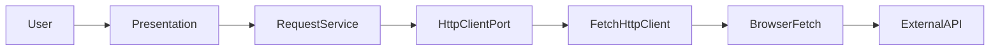

# Software Architecture — ARCH.md

## 1. Overview

### Project Name
Endpt

### Purpose
App present solution for backend (API) Integration and testing easier with lightweight highly-performance app and Let developers create and send requests quickly with minimal setup .

# Architecture Goals

## 1. Desktop-First Architecture
- Design the architecture primarily for a desktop application (Tauri).
- Keep the core business logic independent of the desktop UI framework and platform-specific APIs.
- Allow the core functionality to be reused in other environments in the future without requiring significant architectural changes.

## 2. Technology Independence
- Keep the request execution engine independent of the UI layer and the underlying implementation technology.
- Define clear interfaces (ports) for request execution, data persistence, and remote communication — for example, an `HttpClient` port for HTTP transport.
- Allow request execution to use JavaScript's Fetch API (`FetchHttpClient`) or a native desktop HTTP adapter without changing the UI or Application Layer unnecessarily.

## 3. Maintainability
- Ensure each architectural layer has a clearly defined responsibility.
- Allow individual layers to be modified, replaced, or extended without causing unintended changes in other layers.
- Minimize coupling between components and use explicit ports/interfaces for communication between them.

## 4. Modularity
- Organize the application into cohesive, independently manageable modules under `modules/`, including:
  - **Request:** Application `RequestService`, HTTP ports, and Infrastructure HTTP adapters (Request Engine).
  - **Response:** Displays response status, headers, body, and performance information.
  - **Projects / Collections:** Manage project metadata, collections, folders, and saved requests.
  - **Environment:** Environment variables and placeholder resolution.
  - **Account / Sync:** Optional accounts and cloud sync.
  - **Persistence:** Local storage adapters (separate from HTTP execution).
- Ensure that each module exposes a clear interface and does not depend unnecessarily on other modules' internal implementations.
- Within modules, separate Presentation, Application, Infrastructure, and Ports where needed.

## 5. Performance
- Target an initial desktop window display within **350 ms** on defined reference hardware.
- Target completion of local request-editor navigation and rendering within **450 ms**.
- Target loading locally available projects, collections, and requests within **450 ms**.
- Keep the UI responsive during network requests, synchronization, and large-response processing.
- Avoid blocking application startup or navigation while waiting for remote data.

*Performance targets must be validated through profiling and measured under documented test conditions.*

## 6. Reliability and Fault Tolerance
- Handle unavailable network connections and remote service failures without crashing the application.
- Validate request URLs, headers, query parameters, and body configuration before execution where applicable.
- Provide clear error information for invalid requests, network/transport failures, timeouts, and HTTP responses (including 4xx and 5xx).
- Preserve locally saved projects, collections, and requests when the application is offline.
- Recover gracefully from unexpected failures and avoid losing unsaved user changes.

## 7. Testability of the Request Engine
- Test the request execution engine independently of the UI.
- Verify HTTP methods, URL construction, headers, query parameters, request bodies, response handling, timeouts, and error handling.
- Use mocked `HttpClient` implementations or a controlled test server to ensure tests are repeatable.
- Make dependencies such as the network transport and configuration injectable or replaceable during testing.

## 8. Testability of Data and Business Logic
- Test project, collection, and saved-request operations independently of the UI.
- Verify data validation, creation, retrieval, updates, deletion, and relationships between entities.
- Test local persistence and remote synchronization separately from application orchestration.
- Use in-memory storage or mocked persistence ports for fast, deterministic unit tests.

## 9. Offline-First Data Access
- Make locally stored projects, collections, and requests available without an internet connection.
- Separate local persistence from remote API communication (HTTP execution vs storage).
- Load local data first and synchronize remote changes when connectivity is available.
- Define explicit conflict-resolution rules for changes made on multiple devices or in multiple sessions.

## 10. Security
- Store sensitive values such as API tokens, passwords, and authorization secrets securely.
- Keep secrets out of application logs, exported collections, and shared data by default.
- Validate data at appropriate boundaries and avoid exposing sensitive information unnecessarily.
- Apply the desktop platform's available secure-storage mechanisms where appropriate.


---

## 2. Requirements & Constraints

### Functional Requirements
See [`PRD.md`](./PRD.md). Core to this architecture: ad-hoc HTTP requests (FR-01–FR-07), response viewing (FR-08–FR-10), environment variables (FR-11–FR-14), local-first data with optional sync (FR-15–FR-18), and Project → Collection → Request (FR-19–FR-21).

### Non-Functional Requirements
- **Performance:** Responsive UI; lightweight request/response handling (NFR-01; Architecture Goals §5).
- **Security:** Secrets at rest; protect sync in transit (NFR-02; Architecture Goals §10).
- **Reliability:** Full offline core workflows; consistent local-first data (NFR-03).
- **Maintainability:** Clear layer and module boundaries; injectable ports for testing.
- **Portability:** Desktop app on major platforms via Tauri (NFR-05).

### Technical Constraints
- TypeScript + React UI; Tauri desktop shell.
- Application Layer depends on ports, not concrete Infrastructure.
- Presentation must not execute HTTP requests directly.
- KISS: no Domain Layer unless real domain rules justify it; no DI framework required.
- This document describes a layered modular design with ports; it does **not** claim full Clean Architecture or Hexagonal Architecture.

---

## 3. High-Level Architecture

### Architecture Style
Modular desktop application (Tauri + React + TypeScript). Responsibilities are grouped by module under `modules/`, with Presentation, Application, Infrastructure, and Ports layers inside modules as needed. Not a microservices system.

### Architecture Overview
The Presentation Layer collects request configuration and displays results. The Application Layer (`RequestService`) validates, prepares, and coordinates sending. Transport goes through an `HttpClient` port; Infrastructure provides concrete adapters (for example `FetchHttpClient`). Persistence uses separate storage adapters and must not be mixed into HTTP execution.

This layering supports testability and technology independence. It is intentionally simple and is not a full Clean Architecture or Hexagonal Architecture adoption.

### Architecture Layers

#### 1. Presentation Layer
- Responsible for UI components and user interactions.
- Collects request configuration.
- Displays validation errors, loading states, responses, and execution errors.
- Must not execute HTTP requests directly (no Fetch or other transport calls from UI).

#### 2. Application Layer
- Contains `RequestService`.
- Coordinates the request execution workflow.
- Performs application-level validation and request preparation.
- Depends on abstractions (ports), not concrete Infrastructure implementations.

#### 3. Infrastructure Layer
- Contains concrete implementations of technical capabilities.
- Implements the `HttpClient` port (for example `FetchHttpClient` using the browser Fetch API).
- May contain storage implementations and other platform-specific integrations when required.
- Must not contain application orchestration or UI logic.

#### 4. Ports / Abstractions
- Define contracts required by the Application Layer.
- Keep interfaces independent of concrete Infrastructure implementations.
- Example: `HttpClient`.

### Dependency Inversion and Injection
- `RequestService` depends on the `HttpClient` abstraction.
- `FetchHttpClient` implements that abstraction inside Infrastructure.
- The concrete implementation is injected into `RequestService` at the composition root (app or module wiring).
- No DI framework or complex dependency container is required — constructor or factory injection is enough.

### Request Execution Flow

```text
Presentation → RequestService → HttpClient (port) → FetchHttpClient → Browser Fetch API → External API
```

The response travels back through the same chain.



Persistence and storage are outside this HTTP path. When a storage adapter is needed, it lives under Infrastructure separately from network adapters.

### Design Constraints
- Follow KISS; avoid unnecessary abstractions.
- Do not introduce a Domain Layer unless actual domain rules justify it.
- Do not claim that the project fully implements Clean Architecture or Hexagonal Architecture.
- Keep HTTP execution separate from persistence/storage.
- Preserve the distinction between HTTP responses (including 4xx and 5xx) and network/transport failures.
- Do not assume every response body is JSON.
- Product target is desktop-first (Tauri). `FetchHttpClient` is one injectable Infrastructure adapter. When that adapter is used, account for Fetch API permissions and execution-context limits (including browser-extension-style constraints if applicable). A native desktop HTTP adapter may replace or sit beside Fetch behind the same `HttpClient` port without changing Presentation or Application.

---

## 4. Technology Stack

| Area | Technology | Reason |
|---|---|---|
| Desktop shell | Tauri | Desktop-first, lightweight native window |
| UI | React + TypeScript | Component UI; typed Presentation Layer |
| Build | Vite | Fast local tooling |
| HTTP (adapter) | `FetchHttpClient` (Fetch API) behind `HttpClient` port | Injectable, testable; swappable for native HTTP later |
| Local persistence | Platform-appropriate store (see implementation plan) | Offline-first; separate from HTTP |
| Auth / secrets | Account flows + secure storage (PRD NFR-02) | Secrets not in plaintext logs/exports |
| Testing | Unit tests with mocked ports; integration as needed | Request engine testable without UI |

---

## 5. System Components

| Component | Responsibility | Dependencies |
|---|---|---|
| Presentation (request UI) | Collect config; show loading, validation, response, errors | `RequestService` |
| `RequestService` | Validate, prepare, orchestrate send | `HttpClient` port |
| `HttpClient` (port) | Contract for HTTP transport | None (abstraction) |
| `FetchHttpClient` | Concrete Fetch-based transport | Browser Fetch API |
| Persistence adapters | Local projects, collections, requests, env, settings | Storage APIs (not HTTP send path) |
| Response Viewer | Present status, headers, body, timing | Response data from Application / Presentation |

### Component Details

#### RequestService

**Responsibility:**  
Coordinate request execution: application-level validation, preparation, and calling the `HttpClient` port.

**Inputs:**  
Request configuration from Presentation (method, URL, headers, params, body, auth as applicable).

**Outputs:**  
Structured result for Presentation: HTTP response data (status, headers, body, timing) or a transport/validation failure.

**Dependencies:**  
`HttpClient` port only (concrete client injected).

#### FetchHttpClient

**Responsibility:**  
Implement `HttpClient` using the browser Fetch API.

**Inputs:**  
Normalized request from Application via the port.

**Outputs:**  
Transport result: completed HTTP response (any status, including 4xx/5xx) or network/transport failure. Body handling must not assume JSON.

**Dependencies:**  
Browser Fetch API (subject to permissions and execution context when this adapter is used).

---

## 6. Data Flow

### Send HTTP request

1. User configures method, URL, params, headers, body, and auth in Presentation.
2. Presentation calls `RequestService` (does not call Fetch or any transport directly).
3. `RequestService` validates and prepares the request, then calls `HttpClient`.
4. Injected `FetchHttpClient` performs the call via the browser Fetch API to the external API.
5. Result returns: `FetchHttpClient` → port → `RequestService` → Presentation.
6. Presentation shows loading while in flight, then response content or a clear validation / HTTP / transport error.

---

## 7. Data Model & Storage

### Main Entities
See [`DATA_MODEL.md`](./DATA_MODEL.md). Summary: `AdHocRequest`, `Project` → `Collection` → `SavedRequest`, `EnvironmentVariable`, `UserAccount` / `UserSettings`, sync-related fields as needed.

### Storage Strategy
- **Persistent Storage:** Local-first store for projects, collections, requests, env vars, and settings. Implemented as Infrastructure storage adapters when required — separate from `FetchHttpClient` / HTTP execution.
- **Temporary Storage:** In-memory UI/request-builder state during a session.
- **Caching:** Not required for the HTTP send path; local load-first for offline data access.

### Data Model Reference
See [`DATA_MODEL.md`](./DATA_MODEL.md).

---

## 8. State Management

### State Categories
- **Local State:** Component-owned UI state (editors, tabs, loading flags).
- **Shared State:** Active request draft, last response, selected project/collection when used.
- **Persistent State:** Saved entities that survive restarts (ad-hoc draft, projects, collections, env vars, settings).

### State Management Strategy
Presentation owns ephemeral UI state. Application coordinates send and validation. Persistence adapters read/write durable entities. HTTP send does not write through the network client into storage; save/load is a separate path.

---

## 9. Error Handling & Logging

### Error Categories
- **Validation Errors:** Invalid URL, headers, params, or body configuration — caught in Application (and optionally reflected early in Presentation); do not hit the network.
- **HTTP Responses (4xx / 5xx):** Successful transport with an error status — treated as response data for the Response Viewer, not as transport failure.
- **Network / Transport Errors:** Connection failures, DNS issues, aborts, timeouts, permission/context failures from Fetch — distinct from HTTP status responses.
- **Unexpected Errors:** Uncaught failures; surface a safe message; avoid crashing the app; preserve unsaved work where possible.

### Logging Strategy
Log enough to diagnose send failures (method, host, timing, error category). Exclude secrets (tokens, passwords, API keys) from logs and shared exports by default.

---

## 10. Security

- **Authentication:** Optional user account sign-up / sign-in for sync and preferences (PRD); request AuthConfig applies to outbound API calls when enabled.
- **Authorization:** Local data is user-scoped on device; cloud sync follows account linkage when used.
- **Data Protection:** Encrypt sensitive env and auth fields at rest per NFR-02.
- **Secrets Management:** Prefer platform secure storage; never log or export secrets by default.
- **Input Validation:** At Application boundaries before send; Presentation may show inline errors.
- **External Communication:** HTTPS to user-chosen APIs; sync (when enabled) must protect data in transit.

---

## 11. Performance & Scalability

### Performance Considerations
- Large response bodies: stream or defer heavy formatting so the UI stays responsive.
- Avoid blocking startup on remote sync.
- Keep Presentation free of transport work so loading states stay accurate.

### Scalability Strategy
Local-first desktop usage; scale by keeping modules and ports replaceable (e.g. native HTTP adapter) rather than by splitting into services.

### Resource Management
Cancel or ignore stale in-flight requests when the user sends again; avoid unbounded response buffering in the UI thread.

---

## 12. Project Structure

Guideline for layering inside modules. Only create folders and files that are needed — do not require empty directories (for example, add `infrastructure/storage/` only when a storage adapter exists).

```text
modules/
├── request/
│   ├── application/
│   │   └── services/
│   │       └── request.service.ts
│   ├── infrastructure/
│   │   └── network/
│   │       └── fetch-http-client.ts
│   ├── ports/
│   │   └── http-client.interface.ts
│   └── types/
│       └── http.types.ts
├── response/
├── project/
├── environment/
├── account/
└── sync/
src/                    # app shell / Presentation composition
```

Other modules follow the same idea when they need Application logic, ports, or Infrastructure adapters. Align module ownership with [`DATA_MODEL.md`](./DATA_MODEL.md) §8 and the implementation plan.

### Module Organization
- **request:** Send pipeline — `RequestService`, `HttpClient`, `FetchHttpClient`.
- **response:** Response viewing concerns.
- **project:** Projects and collections.
- **environment:** Variables and `{{key}}` resolution used before send.
- **account / sync:** Optional identity and cloud sync.
- **src:** Tauri/React shell wiring (composition root injects Infrastructure into Application).

---

## 13. Testing Strategy

- **Unit Tests:** `RequestService` with a mocked `HttpClient`; URL/header/body preparation; validation; distinction between HTTP status results and transport failures.
- **Integration Tests:** `FetchHttpClient` (or a desktop HTTP adapter) against a controlled test server when needed.
- **End-to-End Tests:** Ad-hoc send and response viewing in the desktop app as the product matures.
- **Performance Tests:** Validate Architecture Goals §5 targets under documented conditions.

---

## 14. Deployment & Runtime

### Runtime Environment
Desktop (Tauri) on major desktop platforms. `FetchHttpClient` uses the Fetch API available in the webview; respect that context’s permissions. A future native HTTP adapter may run outside Fetch constraints behind the same port.

### Build Process
Vite + Tauri build pipeline (`pnpm` / project scripts as documented in the README).

### Deployment Strategy
Distribute as a desktop application build (platform installers via Tauri). Details tracked with product release process.

### Environment Configuration
Local development vs production builds via standard Vite/Tauri env configuration; no requirement for a remote backend to send user-configured API requests.

---

## 15. Architecture Decision Records (ADRs)

### ADR-001: Layered modules (Presentation, Application, Infrastructure, Ports)

- **Status:** Accepted
- **Context:** Need clear boundaries so UI does not own HTTP transport and so persistence stays separate from send.
- **Decision:** Organize by `modules/` and use Presentation / Application / Infrastructure / Ports inside modules as needed.
- **Alternatives:** Flat `src/services` without ports; full Clean/Hexagonal stack with Domain Layer.
- **Consequences:** Clear dependencies and test seams; KISS without claiming Clean or Hexagonal completeness; no Domain Layer for MVP.

### ADR-002: `HttpClient` port with injectable `FetchHttpClient`

- **Status:** Accepted
- **Context:** Request execution must be testable and swappable (Technology Independence) while the product remains desktop-first.
- **Decision:** Application depends on `HttpClient`; Infrastructure provides `FetchHttpClient` (Fetch API) as an injectable adapter. Native desktop HTTP may be added later behind the same port.
- **Alternatives:** Call Fetch directly from UI; hard-code Tauri HTTP only with no port.
- **Consequences:** Easy mocking; Fetch permission/context limits apply only to the Fetch adapter; composition root wires the concrete client.

### ADR-003: No DI framework

- **Status:** Accepted
- **Context:** Need injection for testability without heavy tooling.
- **Decision:** Manual injection at the composition root (constructor or simple factory).
- **Alternatives:** DI container / framework.
- **Consequences:** Less ceremony; wiring stays explicit and small.

### ADR-004: No Domain Layer for MVP

- **Status:** Accepted
- **Context:** MVP rules are mostly validation and orchestration, not rich domain invariants.
- **Decision:** Omit a Domain Layer until real domain rules justify it.
- **Alternatives:** Introduce entities/use-case domain packages now.
- **Consequences:** Simpler tree; Application + ports cover current needs.

---

## 16. Risks & Trade-offs

| Risk | Impact | Mitigation |
|---|---|---|
| Fetch adapter limited by webview permissions / CORS / context | Medium | Document constraints on `FetchHttpClient`; keep `HttpClient` so a native adapter can replace it |
| Over-layering slows delivery | Medium | KISS; only add folders/files when needed; no Domain Layer unless justified |
| Conflating HTTP 4xx/5xx with transport failure | High | Explicit error categories; treat status responses as response data |
| Assuming JSON bodies | Medium | Port and viewer handle content types / raw text; parse only when appropriate |

---

## 17. Open Questions

- When to introduce a native desktop HTTP Infrastructure adapter vs continuing with `FetchHttpClient` in the Tauri webview.
- Exact local persistence technology (SQLite vs Tauri store) — see implementation plan Phase 1.
- Align [`IMPLEMENTATION_PLAN.md`](./IMPLEMENTATION_PLAN.md) Phase 2 wording with this document’s port + adapter model (desktop-safe HTTP as an alternative adapter, not a contradiction of the `HttpClient` port).

---

## 18. References

- [`PRD.md`](./PRD.md) — Product requirements
- [`DATA_MODEL.md`](./DATA_MODEL.md) — Data structures and relationships
- [`IMPLEMENTATION_PLAN.md`](./IMPLEMENTATION_PLAN.md) — Phased delivery
- [`UI_UX_SPEC.md`](./UI_UX_SPEC.md) — UI specification
- [`API_SPEC.md`](./API_SPEC.md) — API contracts, if applicable
- [`SECURITY.md`](./SECURITY.md) — Detailed security requirements, if needed
