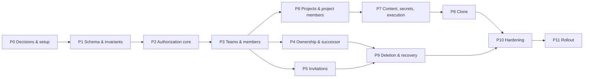

# IMPLEMENTATION_PLAN — Endpt Teams, Memberships & Projects

**Inputs:** Team Business Rules v2.0, Endpt Data Model v1.0 (`endpt_schema.sql`)
**Assumed team:** 2 backend engineers, 1 frontend engineer, part-time QA/security review
**Assumed stack:** PostgreSQL 15+, any backend framework (plan is stack-neutral; adapt tooling names)
**Total estimate:** ~15 weeks to GA, with a usable internal alpha at the end of week 8

---

## 1. Guiding Principles

1. **Invariants live in the database first.** Constraints, partial unique indexes and triggers ship before any API, so no code path can corrupt state.
2. **One authorization layer.** All checks go through a single `authorize(actor, permission, resource)` function backed by one permission map. No role-name checks in handlers.
3. **Every state-changing operation is a single transaction** that locks the team row, re-validates, writes, and records an audit event.
4. **Test the rules, not just the endpoints.** The Role Management Matrix, Role Change table, and Effective Permission logic are table-driven tests generated from the spec.
5. **Ship vertically in slices** that are demoable: each phase ends with working API + minimal UI + tests.

---

## 2. Phase Overview

| Phase | Name                        | Duration | Milestone                                |
| ----- | --------------------------- | -------- | ---------------------------------------- |
| P0    | Decisions & setup           | 1 wk     | Assumptions signed off                   |
| P1    | Schema & invariants         | 1.5 wk   | DB invariant tests green                 |
| P2    | Authorization core          | 1.5 wk   | Matrix tests green                       |
| P3    | Teams & members             | 2 wk     | **Alpha-A:** create team, manage members |
| P4    | Ownership & successor       | 1 wk     | Transfer / leave flows                   |
| P5    | Invitations                 | 2 wk     | **Alpha-B:** invite → join               |
| P6    | Projects & project members  | 1.5 wk   | Team projects with access control        |
| P7    | Content, secrets, execution | 2 wk     | **Alpha-C (wk 8–9):** usable end to end  |
| P8    | Clone                       | 1.5 wk   | Personal → Team                          |
| P9    | Deletion & recovery         | 1.5 wk   | Soft delete, purge job, warnings         |
| P10   | Hardening                   | 2 wk     | Security review, load, concurrency       |
| P11   | Rollout                     | 1 wk     | Beta → GA                                |

Phases P4, P5, P6 can run in parallel after P3 with two backend engineers (reflected in the total).

---

## 3. Phase Details

### P0 — Decisions & Setup (week 1)

**Goal:** remove ambiguity before code.

- [ ] Product owner confirms the seven assumptions in Rules §16.2 (Viewer execution, Editor Clone, secret Reveal, inviter-revocation, purge acceleration, limits, Clone paths).
- [ ] Choose ORM / migration tool, test framework, job queue, email provider, secret-encryption approach (KMS).
- [ ] Create repo structure: `domain/` (pure rules), `db/` (migrations), `api/`, `jobs/`.
- [ ] CI pipeline: lint, unit tests, DB tests against a real PostgreSQL container.
- [ ] Define error-code catalog (e.g. `ALREADY_A_MEMBER`, `OWNER_CANNOT_LEAVE_NO_SUCCESSOR`, `ROLE_EXCEEDS_CEILING`).

**Exit criteria:** signed-off decisions, green empty CI, error catalog merged.

---

### P1 — Schema & Invariants (weeks 2–3)

**Goal:** the database enforces every rule it can.

- [ ] Migrations from `endpt_schema.sql`, split per domain (identity, teams, projects, invitations, content, audit).
- [ ] Implement the three triggers (successor validity, project-membership validation, team-membership cascades).
- [ ] Seed/fixture helpers for tests (team with Owner, Admin, Editor, Viewer).
- [ ] **DB invariant tests** (run directly in SQL or via the data layer):
  - second active Owner rejected
  - duplicate active membership rejected
  - Successor must be active Admin; cleared when demoted/ended
  - project membership rejected for Owner/Admin and for roles above ceiling
  - promotion to Admin ends explicit project memberships
  - Editor → Viewer lowers project roles
  - invitation constraints (no Owner, no Admin link, expiry window, `max_uses`)
  - one pending email invitation per team + email
  - secret/non-secret variable shape
  - cross-team project membership impossible (composite FKs)

**Exit criteria:** all invariant tests pass; migrations apply and roll back cleanly.

---

### P2 — Authorization Core (weeks 3–4)

**Goal:** a single, exhaustively tested policy engine.

- [ ] Permission map constants for Team (§4) and Project (§5) matrices.
- [ ] `authorize()` implementing the Effective Permission order (§6): team status → team membership → team permission → implicit access or project membership → ceiling cap.
- [ ] `canManageMember(actor, target, operation, newRole?)` implementing the Role Management Matrix (§3.1).
- [ ] Table-driven tests generated from the spec tables: **every row of §3.1, §4, §5.1, §7** is a test case, plus negative cases for anything not listed.
- [ ] Middleware / decorator so handlers declare the permission key they require; a lint rule or test fails if a route lacks one.

**Exit criteria:** 100% of matrix rows covered; no handler without a declared permission.

---

### P3 — Teams & Members (weeks 4–6)

**Goal:** create teams and manage membership safely.

- [ ] Team CRUD: create (creator becomes Owner), read, update (`team.update`).
- [ ] Member list; change role; remove member; leave team — all via `canManageMember`.
- [ ] Standard transaction wrapper: `BEGIN` → lock team row → authorize → write → audit → `COMMIT`.
- [ ] Audit log writer (§14.1) with before/after state; secret-safe.
- [ ] Role-change UI warnings (Admin demotion loses implicit access).
- [ ] "Former Member" display for `created_by` / `updated_by`.
- [ ] Notification service skeleton (in-app + email adapter).
- [ ] Limits: members per team, teams per user.

**Tests:** matrix integration tests via API; concurrent role changes on the same team serialize correctly.

**Exit criteria (Alpha-A):** team creation and full member management demoable, audited.

---

### P4 — Ownership & Successor (week 7, parallel)

- [ ] Set / change / clear Successor (`team.successor.manage`).
- [ ] Auto-clear on invalid Successor + Owner notification (trigger + notification dispatch).
- [ ] Ownership Transfer without leaving (demote old Owner first, then promote — see Data Model §4.2).
- [ ] Owner leave (capture Successor first, end old, promote — Data Model §4.1) and `OWNER_CANNOT_LEAVE_NO_SUCCESSOR` with the three guidance paths.
- [ ] Owner account-deletion guard (§10.5): block with team list, auto-transfer when a valid Successor exists.

**Tests:** Owner leaves while Successor is simultaneously demoted (race); Owner leaves with no Admin; transfer keeps Implicit Access for the old Owner.

---

### P5 — Invitations (weeks 7–8, parallel)

- [ ] Token generation (≥128-bit), SHA-256 storage, one-time display.
- [ ] Email invitation (bound to verified email) and link invitation (`max_uses` 1–100).
- [ ] Role rules: Owner never; Admin only by Owner via email; links Editor/Viewer only.
- [ ] Expiry defaults (7 days) and bounds (1 h – 30 d).
- [ ] Accept flow: duplicate-member rejection **without consuming**, atomic `uses_count` update, membership insert, acceptance record (Data Model §4.4).
- [ ] Revoke; Resend (revoke old, create new, link via `replaced_by_id`).
- [ ] Auto-revoke pending invitations when the inviter loses permission (hooked into role change / remove / leave).
- [ ] Rate limiting on accept (10/min per user, 20/min per IP); uniform error responses.
- [ ] Email templates; pending-invitation limit (100 per team).

**Tests:** concurrent acceptance of a `max_uses = 1` link (exactly one succeeds); email mismatch; expired / revoked / exhausted all return the same error shape; resend leaves exactly one pending invitation.

**Exit criteria (Alpha-B):** invite → accept → join works for both types.

---

### P6 — Projects & Project Members (week 8–9, parallel)

- [ ] Team Project create / delete (`team.projects.create`, `team.projects.delete`); Project Admin cannot delete.
- [ ] Project member list with the separate "Implicit Administrators" section.
- [ ] Add / change / remove project members; only Active team members; ceiling enforced; Owner/Admin rejected.
- [ ] Project-without-Project-Admin detection and notification (§5.3).
- [ ] Project list for a user (effective access query, Data Model §5).
- [ ] Settings management (`project.settings.manage`).

**Tests:** Editor as Project Admin manages members but cannot touch team-level resources; Viewer cannot be Project Editor; promotion/demotion cascades visible through the API.

---

### P7 — Content, Secrets & Execution (weeks 9–10)

- [ ] Collections, Requests, Environments, Variables CRUD with the project permission map.
- [ ] Secret handling: `is_secret` flag, envelope encryption, always-masked responses, write-only update, **no Reveal endpoint**.
- [ ] Request execution (`request.execute`): server-side secret injection; mask secrets in stored request/response logs **before** insert.
- [ ] Execution history: `history.view_own` vs `history.view_all`.
- [ ] Tests for secret leakage: assert secrets never appear in API responses, logs, audit entries, or execution history.

**Exit criteria (Alpha-C):** a team can be created, invited, given projects, and can run requests with secrets, end to end.

---

### P8 — Clone Personal → Team (weeks 11–12)

- [ ] Authorization: owner of source **and** `team.projects.create` in target; reject Team→Team, Team→Personal, Personal→Personal with clear errors.
- [ ] Size limit (5,000 requests) checked before writing.
- [ ] Single transaction: project, collections, requests, environments, variables with ID remapping.
- [ ] Sanitization (§8.4): secret keys with empty values; auth values and sensitive headers emptied; produce a "what was cleared" report for the UI.
- [ ] `source_project_id` stored but excluded from all team-facing responses.
- [ ] Skip history, logs, members, secret values.
- [ ] Failure injection test: abort mid-clone leaves no partial project.

---

### P9 — Deletion & Recovery (weeks 12–13)

- [ ] Soft delete (Owner): status change, 30-day `purge_after`, revoke pending invitations; access checks fail fast on team status.
- [ ] Block leave/remove/role-change during deletion; slug stays reserved.
- [ ] Restore (Owner only, before purge); invitations are **not** restored.
- [ ] Purge job: `deleted → deleting`, batched content deletion, then team row; resumable and idempotent.
- [ ] Warning job: notifications at 7 days and 1 day before purge.
- [ ] Owner account deletion with a soft-deleted team: confirmation + accelerated purge.
- [ ] Audit retention (≥12 months) and metadata-only record after purge.

**Tests:** purge interrupted halfway resumes cleanly; cloned source projects survive; slug freed only after purge; restore returns memberships and projects intact.

---

### P10 — Hardening (weeks 13–14)

- [ ] **Concurrency suite:** parallel role changes, parallel Owner operations, parallel invitation acceptance, parallel Clone, role change during Clone.
- [ ] **Security review:** authorization bypass attempts (IDOR across teams, forged role fields), secret exfiltration paths, token brute-force, invitation enumeration.
- [ ] Penetration-style tests on every endpoint using a Viewer, a former member, and a member of another team.
- [ ] Evaluate PostgreSQL Row Level Security keyed on `team_id` as a second layer.
- [ ] Performance: indexes verified with `EXPLAIN` on the effective-access query, member lists, audit queries; load test with large teams (100 members, 1,000 projects).
- [ ] Observability: metrics for denied authorizations, invitation failures, purge progress; alerts on purge job failures.
- [ ] Data-integrity monitor: scheduled queries that must return zero rows (e.g., active project membership with ended team membership; team with no active Owner).

---

### P11 — Rollout (week 15)

- [ ] Feature flag per capability (teams, invitations, clone).
- [ ] Internal dogfood → closed beta → GA, with the integrity monitor watched at each step.
- [ ] Runbooks: stuck purge, restore request after deadline, accidental Owner removal recovery.
- [ ] User-facing docs for roles, Clone, and recovery window.

---

## 4. Testing Strategy

| Layer             | What                                          | Source of truth                             |
| ----------------- | --------------------------------------------- | ------------------------------------------- |
| DB invariants     | Constraints, indexes, triggers                | `endpt_schema.sql`                          |
| Policy unit tests | Matrix, Effective Permission, ceiling         | Rules §3, §4, §5, §6, §7 (generated tables) |
| Integration       | Every endpoint × actor role × expected result | Rules + error catalog                       |
| Concurrency       | Races on Owner, Successor, invitations, Clone | Rules §15                                   |
| Security          | Secret leakage, IDOR, brute force             | Rules §5.1, §12.8                           |
| Jobs              | Purge, warnings, idempotency                  | Rules §11                                   |
| Contract/E2E      | Alpha scenarios per milestone                 | This plan                                   |

**Coverage rule:** every numbered rule in the Business Rules must map to at least one test; keep a `rules-coverage.md` that lists rule → test file.

---

## 5. Definition of Done (per task)

- Migration + rollback tested
- Authorization declared and tested for every actor role
- Runs inside the standard transaction wrapper (lock, authorize, write, audit)
- Audit event emitted
- Error codes from the catalog
- No secret in logs/responses (automated check)
- API docs updated

---

## 6. Risks & Mitigations

| Risk                                          | Impact                | Mitigation                                                                              |
| --------------------------------------------- | --------------------- | --------------------------------------------------------------------------------------- |
| Trigger logic diverges from application logic | Inconsistent behavior | Treat triggers as the safety net; tests run both paths; integrity monitor in production |
| Race conditions on Owner/Successor            | Teams without Owner   | Row lock + revalidation in every transaction; concurrency suite in P10                  |
| Open product assumptions change late          | Rework in P2/P5/P7    | Sign-off in P0; isolate in the permission map and config                                |
| Secret leakage via logs or history            | Security incident     | Mask-before-store, leakage tests, security review                                       |
| Large-team purge blocks the database          | Outage                | Batched, resumable purge with `deleting` status; off-peak scheduling                    |
| Invitation abuse (spam, enumeration)          | Reputation, security  | Rate limits, hourly inviter cap, uniform errors                                         |
| Scope creep (Team→Team clone, custom roles)   | Delays                | Explicitly out of scope (below)                                                         |

---

## 7. Out of Scope (this release)

- Clone Team → Personal, Team → Team
- Custom roles or admin-editable permission tables
- Secret Reveal
- Viewer execution
- Multiple Owners
- SSO / SCIM provisioning
- Queryable role-change history (audit log only)

---

## 8. Immediate Next Steps (this week)

1. Product owner reviews and signs off Rules §16.2.
2. Confirm the stack and migration tooling.
3. Open the P0 tickets and the P1 migration branch.
4. Generate the P2 test tables directly from the Rules markdown so spec and tests cannot drift.
